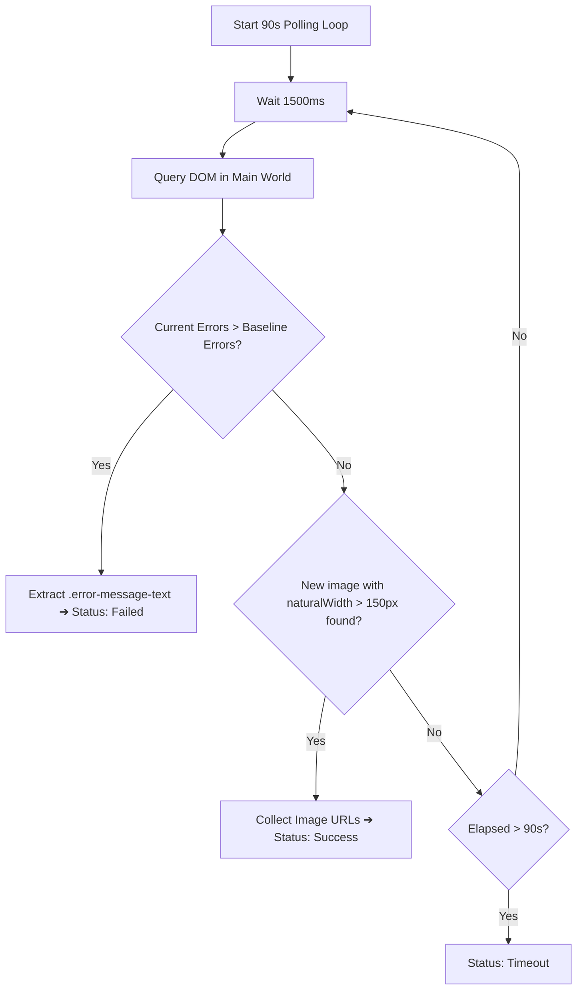

## What is DOM canvas verification in AI automation?

**DOM canvas verification** is the technical process of capturing a baseline snapshot of document object model elements (specifically existing image tags and error containers) prior to prompt submission, then actively polling the page until either a new, unique media identifier appears with verified render dimensions or an error node is detected.

Without canvas verification, automation scripts operate blindly on static timers, unable to distinguish between a successfully generated image, an ongoing render, or a cloud error rejection.

---

## 1. The Pre-Dispatch Baseline Snapshot

Before dispatching keystrokes into Google Flow's ProseMirror editor, Flowmator executes an inspection function in the page's `world: 'MAIN'` execution context via `chrome.scripting.executeScript`:

```javascript
// Flowmator snapshotCanvasState algorithm
async function snapshotCanvasState(tabId) {
  const res = await chrome.scripting.executeScript({
    target: { tabId },
    world: 'MAIN',
    func: () => {
      // 1. Index all existing media elements
      const mediaIds = Array.from(document.querySelectorAll('img[data-media-id], img.image'))
        .map(img => img.getAttribute('data-media-id') || img.src)
        .filter(Boolean);
      
      // 2. Count pre-existing error tiles
      const errorTiles = document.querySelectorAll('flow-error-tile, .error-tile');
      
      return {
        mediaIds: mediaIds,
        errorCount: errorTiles.length
      };
    }
  });
  return res[0]?.result || { mediaIds: [], errorCount: 0 };
}
```

This returns an authoritative snapshot: a `Set` of known image identifiers and an integer count of pre-existing error containers.

---

## 2. The Verification Polling Loop

Once the prompt is injected via Chrome DevTools Protocol, the extension initiates an asynchronous polling loop with a 1,500ms cadence and a 90-second timeout ceiling:



### Key Technical Safeguards:
1. **Dimension Filtering (`naturalWidth > 150`):** Prevents UI avatar icons, UI buttons, and small loading spinners from being falsely recognized as newly generated story frames.
2. **Media-ID Uniqueness:** Confirms that the image node is brand new and not an existing frame re-rendered by Angular change detection.
3. **Error Text Extraction:** If a `<flow-error-tile>` node is detected, Flowmator parses the exact failure reason (e.g. *"Content flagged by safety guidelines"* or *"Unusual traffic"*), updating the UI alert banner with actionable feedback.

---

## 3. Graceful CDP and Scripting Fallbacks

In production environments, browser extensions must contend with strict Content Security Policies (CSP) and multiple extensions competing for debugger access. Flowmator implements a multi-tier fallback architecture:
- **Tier 1 (CDP Hardware Emulation):** Directly connects via `chrome.debugger` to send `Input.insertText` and `Input.dispatchKeyEvent`, guaranteeing `isTrusted: true` events.
- **Tier 2 (In-Page Transaction Dispatching):** If CDP is already attached to another tab or blocked by dev tools, Flowmator falls back to directly interacting with ProseMirror's internal state machine:
  ```javascript
  let pmView = inputEl.pmViewDesc?.pmView;
  const tr = pmView.state.tr.replaceWith(0, pmView.state.doc.content.size, pmView.state.schema.text(text));
  pmView.dispatch(tr);
  ```

This dual-tier approach guarantees reliable prompt delivery across varying Chrome environments.

Explore the complete technical narrative in our [How It Works Guide](/how-it-works).
