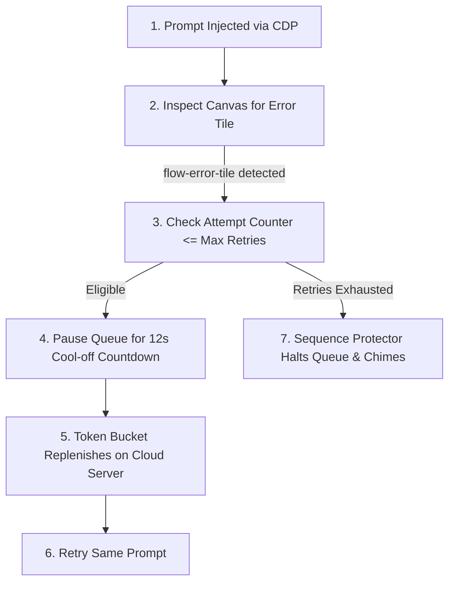

## Why do generative AI platforms enforce rate limits?

**Generative AI platforms enforce rate limits** to prevent cloud GPU clusters from being overwhelmed by automated bots and high-frequency scripts. Google Flow allocates computational capacity in time-windowed token buckets; submitting prompts faster than the bucket can replenish results in temporary generation throttles, represented in Google Flow as `<flow-error-tile>` notices stating *"Unusual activity detected"* or *"Generation failed"*.

Understanding how these rate limits operate allows creators to design automated queues that maximize productivity without triggering platform bans.

---

## 1. The Token Bucket Algorithm in Browser Automation

Most modern cloud APIs (including Google Cloud's Vertex AI and Flow backends) implement variations of the **Token Bucket Algorithm**:
- Your browser session is allocated a capacity bucket (e.g. 5 concurrent generations).
- Each submitted prompt removes a token from the bucket.
- The cloud backend replenishes tokens at a fixed rate (e.g. 1 token every 10–15 seconds).
- If your script submits 6 prompts within 10 seconds, the bucket empties, and subsequent requests fail immediately with rate-limit errors.

---

## 2. The Danger of Immediate Retries

When a generic script encounters a rate-limit error, its default behavior is often to immediately retry the request. This exacerbates the problem:
1. The cloud server receives repeated requests against an empty token bucket.
2. The server's abuse detection system interprets the rapid retry burst as a denial-of-service attack.
3. The temporary 15-second throttle escalates into an extended 15-minute session ban.

---

## 3. The Flowmator Cool-off Strategy

Flowmator implements an automated **Rate-Limit Cool-off Engine** to prevent rate-limit escalation:

### Key Parameters:
- **Rate-Limit Cool-off (Default: 12 seconds):** When an error tile is detected, Flowmator pauses execution completely. A visual countdown timer displays in the side panel, allowing Google's cloud bucket to replenish before the retry is dispatched.
- **Post-Generation Pause (Default: 6 seconds):** Even after a verified successful image render, Flowmator pauses for a few seconds before firing the next scene. This gentle spacing prevents rapid bursts that trip anti-bot heuristics.
- **Randomized Keystroke Jitter (100ms–500ms):** Typing text with authentic variable delays between keystrokes ensures requests appear organic to front-end abuse filters.

---

## 4. Best Practices for High-Volume Queues

To run long batch queues without interruption:
1. **Never set interval delays under 20 seconds** when using Turbo Mode.
2. **Set Auto-Retries to 2:** This gives transient cloud blips two chances to clear while preventing infinite loops on genuine moderation flags.
3. **Keep Safe Sequence Mode enabled** for overnight runs. If a hard rate limit occurs, the Sequence Protector cleanly halts the queue rather than burning through your prompt list.

For diagnostic troubleshooting on specific error tiles, consult our [Google Flow Error Tile Guide](/blog/google-flow-error-tile-troubleshooting).
